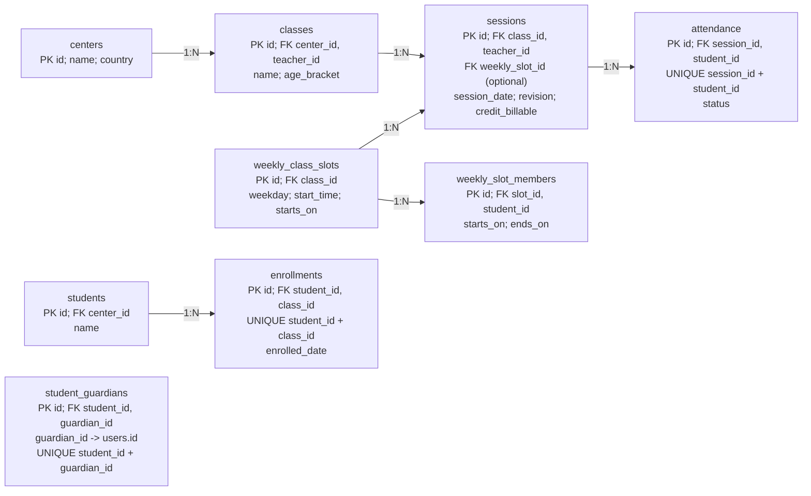

## Current: classes and attendance

CURRENT LOCAL SCHEMA / Selected relationships

Class membership, dated weekly-slot membership and attendance are separate records. They must not be treated as interchangeable. The supplied checklist also requires expected absences and make-up students.
Gap: classes has no dedicated class-code column, and weekly slots have a start time but no end time/duration. The requested timetable needs stable class-code mapping, duration and center time-zone rules. Source: schema.sql:43-93, 2246-2263.
