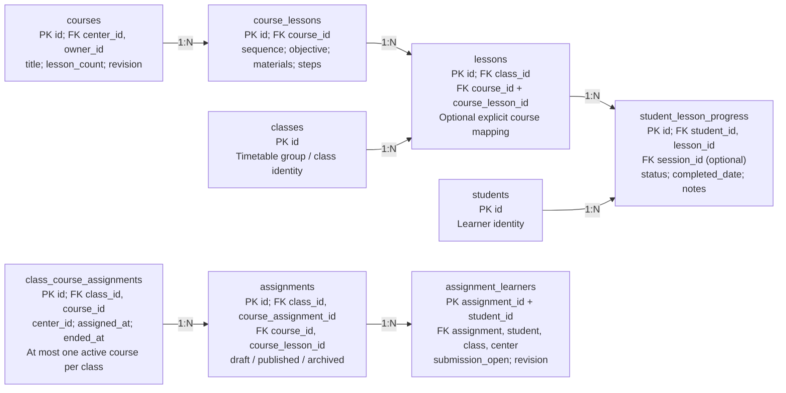

## Current: curriculum and assignments

CURRENT LOCAL SCHEMA / Class-level course assignment

Existing class-course history permits one active course per class. Individual completion records do not solve the requirement for different active modules within the same time slot.
Assignments also reference that class-course link. A future learner-module design must update assignment targeting as well as Journey display; preserve published assignment snapshots, submissions and reviews. Source: schema.sql:993-1348 and 1980-1986.
