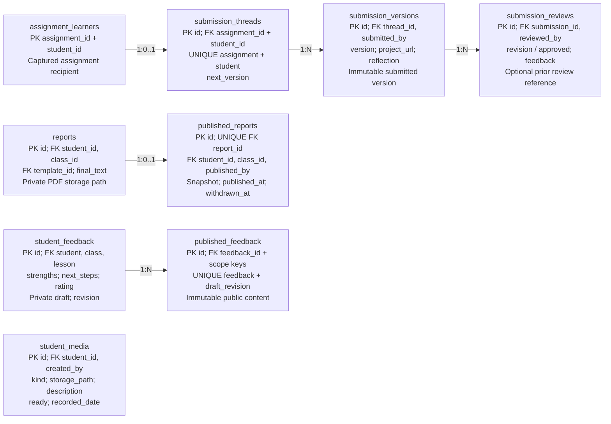

## Current: submissions and publications

CURRENT LOCAL SCHEMA / History and family visibility

Families read their child's permitted submissions and non-withdrawn publications. Private drafts are separate. Existing report publication is one snapshot per report row; a new exported report is required for a new version.
Current student_media is student-linked private Storage metadata; session_videos stores Drive links. Neither is the complete proposed student + session + module + lesson documentation model. Module criterion grades and awards are not yet modeled. Source: schema.sql:684, 1516-1553, 1776-1817, 2350.
