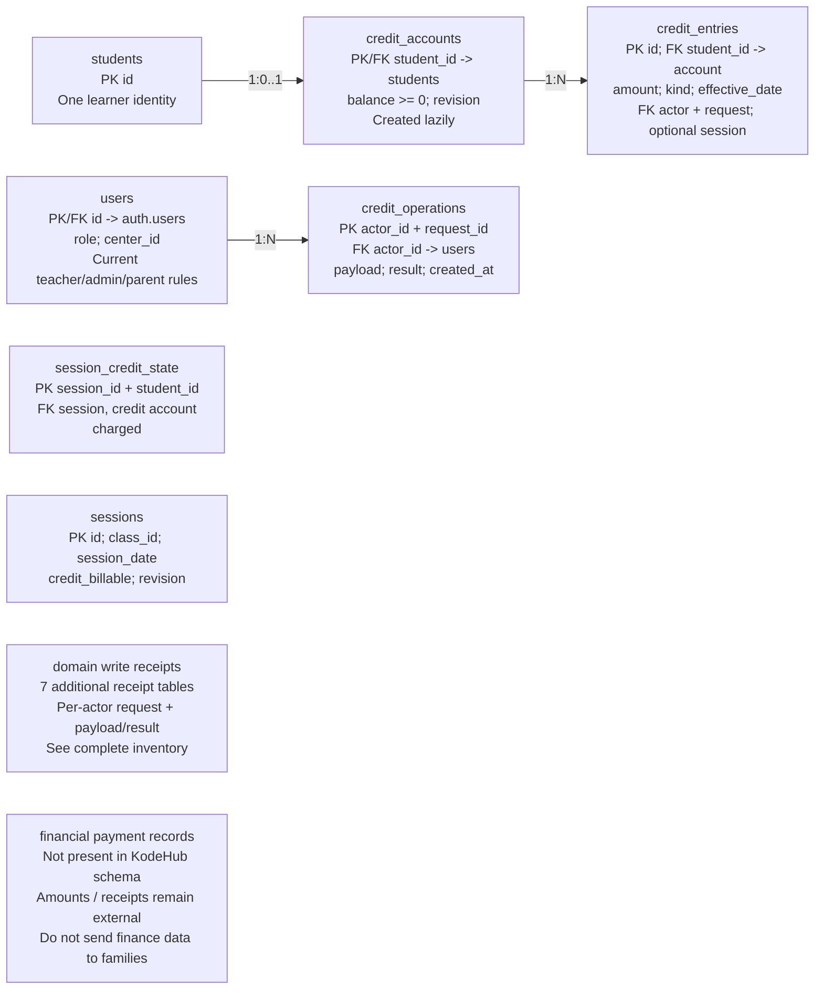

## Current: credits and retry records

CURRENT LOCAL SCHEMA / Credits are session units, not money

Attendance charges/refunds and account changes commit through authorized RPCs. A receipt makes an exact repeated request return its prior result. Not every older endpoint or roster operation has this protection.
Current credit_accounts contains no center_id; scope is derived through the student. The shared design must choose one ledger owner. Finance may grant credit units, while KodeHub consumes/refunds them; neither app should maintain an independent editable balance. Source: schema.sql:764-795.
