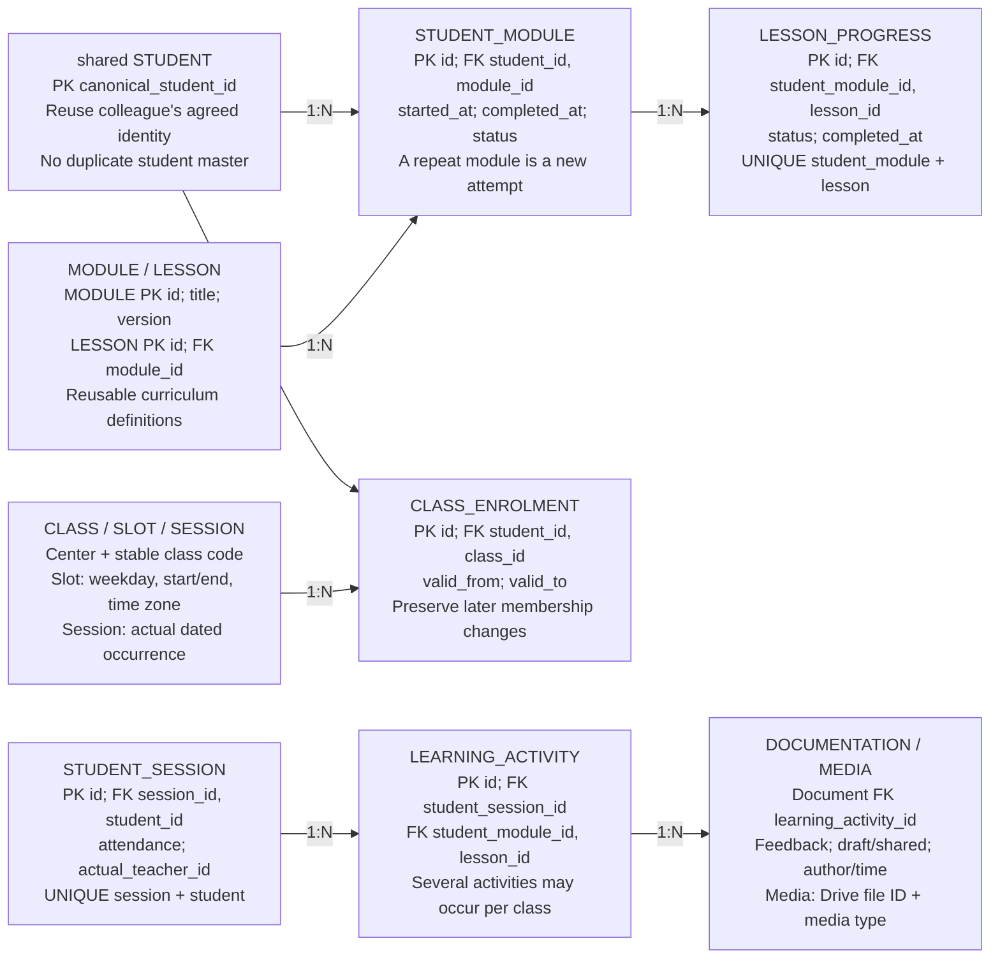

## Proposed: learning belongs to students

PROPOSED / Names and migration mapping require joint review

A class groups students by schedule; each learner has independent module attempts. Each activity links one student's dated session to the module/lesson actually studied. Validate that progress, activity and lesson all refer to the same module and student.
Source mapping is not a migration plan: classes/enrollments/slots remain scheduling concepts; courses/course_lessons are candidates for modules/lessons. Existing class lessons, progress and IDs must be reconciled before conversion. Drive stays academy-controlled; private parent playback remains a release test.
