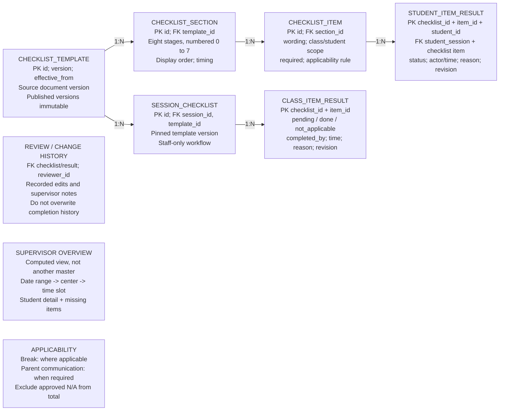

## Proposed: checklist supervision

PROPOSED / Based on supplied 3-page checklist; scope assignments are recommendations

38 checkboxes: Pre-class 7; Before class 4; Opening 5; Delivery 8; Breaktime 3; End of class 5; Parent communication 3; Admin duties 3. Page 3 gives guidance, not extra scored tasks. The PDF does not assign database scope; proposed class/student splits need review.
Overview = completed applicable results / all applicable results for the selected sessions. Count class items once and student items per applicable learner. Show pending separately from overdue; future stages are not yet due. N/A needs a reason; no applicable tasks shows N/A, not 100%.
